<!-- Review draft. Results come from the complete, audited Vera Rubin NVL4
     study. Copy this post and its referenced assets together for publication. -->

Reinforcement learning (RL) for language models connects generation and training in a feedback loop. A policy generates responses, a trainer uses those responses to improve the policy, and the cycle repeats. Both stages evaluate the probabilities assigned to the sampled tokens, making numerical agreement between them part of the learning process.

Each stage is optimized for a different workload. A rollout engine generates responses a few tokens at a time, mixing requests as they arrive and finish. A trainer later processes those responses in larger batches to recompute log probabilities and form updates. For identical weights and token histories, we want both sides to assign the same probabilities. Those different execution choices can cause the numbers to disagree.

One source of that mismatch is below the model: GPU kernels adapt their arithmetic to the workload. A matrix multiplication can use one reduction at decode and another at prefill. Floating-point addition is not associative, so those choices can change output bits. A fixed random seed does not fix a changing reduction order. [Thinking Machines Lab](https://thinkingmachines.ai/blog/defeating-nondeterminism-in-llm-inference/) explains how changing serving batches makes this visible even when each kernel repeats deterministically for a fixed shape.

For RL, the discrepancy reaches the quantities used to update the policy. There is also a performance constraint: rollout throughput matters, and slower consistent kernels can make each training iteration more expensive. The practical target is to preserve numerical behavior while minimizing that performance loss.

At FlashInfer, we have developed a new workflow for authoring GPU kernels that satisfy RL's numerical requirements: determinism, bitwise batch invariance, and consistency across prefill and decode. Our approach starts with a numerical contract: **fix the numerical dataflow, then optimize how the GPU executes it.** We pair [Lean](https://lean-lang.org/) proofs of dataflow identities with bitwise GPU tests that check agreement as tiling, work assignment, and scheduling change. We introduced this mode in FlashInfer [v0.7.4](https://github.com/flashinfer-ai/flashinfer/releases/tag/v0.7.4) for BF16, FP8, MXFP8, NVFP4, and MXFP4 GEMMs on Blackwell and Rubin. In this post, we explain how tuning and controlled split-K fit within the contract, then measure the cost of invariance across decode, middle, and prefill on **NVIDIA Vera Rubin NVL4**, comparing regular and batch-invariant kernels in both untuned and autotuned studies.

## What is batch invariance, and why does it matter for RL?

### What is batch invariance?

Consider a GEMM `A[M, K] × B[K, N] = C[M, N]`. Each row of A holds one token's activations; B holds the weights in the layout used for multiplication (`B = W.T` for a linear layer). M is the number of token rows, while N and K describe the fixed weight shape.

A **bitwise batch-invariant** GEMM gives a token exactly the same output bits regardless of its row position, its neighboring rows, or the total number of rows in the call. Hold the token's input values, B, dtypes, supplied quantization scales, and numerical contract fixed. The requirement is equality of the stored bits, stronger than agreement within a numerical tolerance.

Two transformations make this concrete:

**Permutation invariance.** Reorder the rows of A with a permutation P. The rows of C must follow the same permutation, with every token retaining its output bits. The entire output tensor is therefore permutation-equivariant: it moves with the input. The per-token result is invariant.

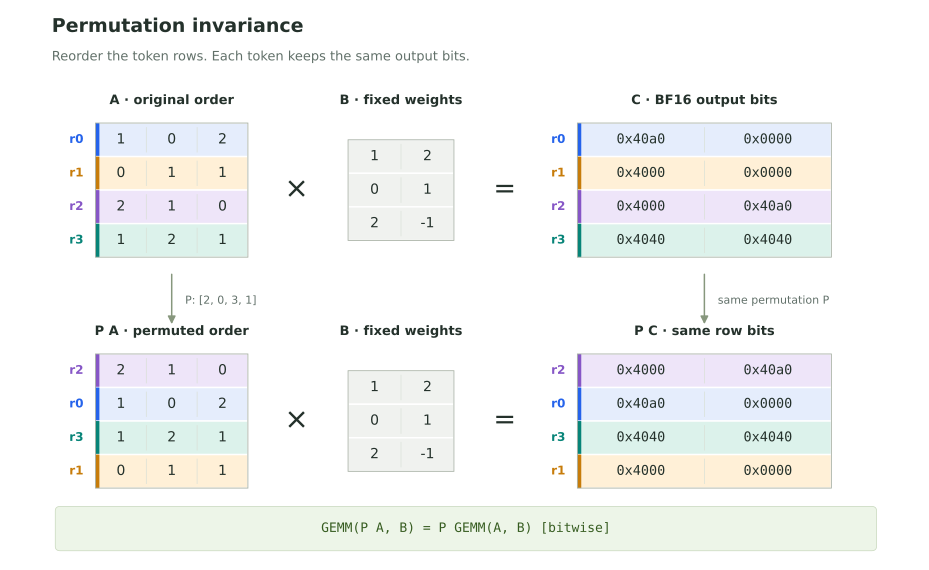

*Permutation invariance: row colors follow token identity through `A × B = C`. The example displays C as BF16 bit patterns in hexadecimal; those patterns move intact with their input rows.*

**Sub-batch invariance.** Split A into smaller batches of rows and run each against the same B. Concatenating their outputs must reproduce the full-batch C bit for bit. In the example, `A0 = A[0:2]` and `A1 = A[2:4]` each have M=2, while the original call has M=4. The equality must survive this change in batch size, including any admitted change in the kernel's launch configuration.

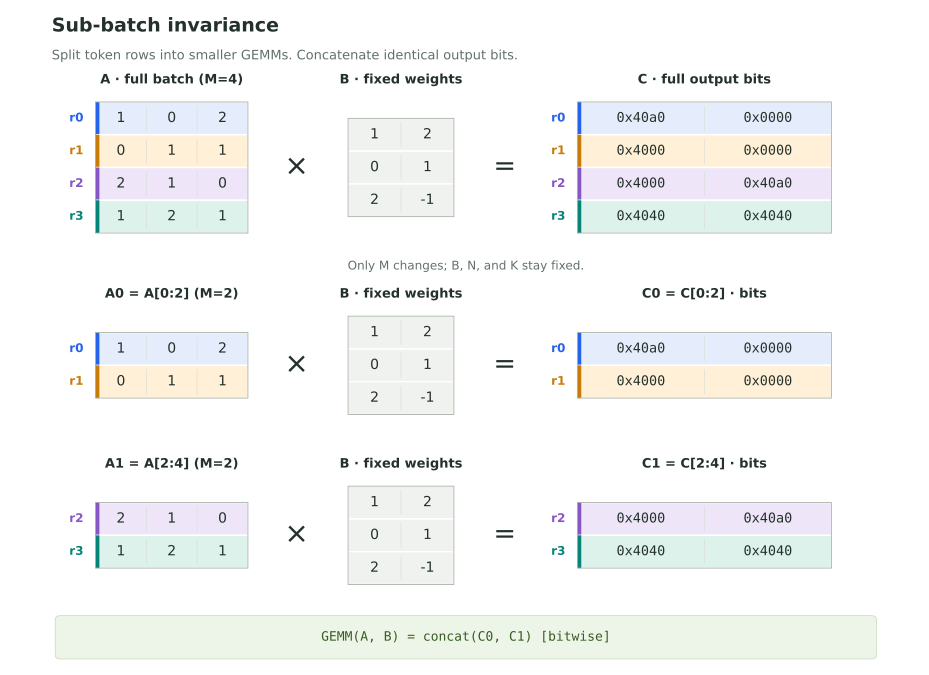

*Sub-batch invariance: the smaller results `C0` and `C1` concatenate to the original C. Only M is partitioned; the weight matrix and the reduction dimension K remain fixed. Both diagrams are illustrative GEMMs showing the required property.*

These transformations rearrange activation rows for the same logical tokens. They do not change token order within a prompt or alter the tokens' attention context.

### Why it matters for RL

RL exercises both transformations routinely. Rollout scheduling changes which token rows share a GEMM, while training microbatches group those rows differently. Matching rollout and training also requires distinguishing several related properties:

| Property | What must remain equal |
| --- | --- |
| Determinism | Repeated executions of the same inputs |
| Batch invariance | A token evaluated under different batching, padding, row order, or sub-batching |
| Configuration agreement | Different admitted kernel configurations for the same numerical class |
| Phase consistency | Different execution paths for the same logical operation, including prefill and decode |

Determinism alone covers the first row. A deterministic kernel can still change its result when M changes. Likewise, two independently batch-invariant implementations can define different accumulation orders. Matching a rollout engine and a trainer requires agreement on the numerical contract as well as invariance within each implementation.

This distinction matters when the trainer re-scores a sampled response. At identical weights and forward semantics, the ratio `exp(logp_train - logp_rollout)` should be 1. A discrepancy introduced by batching or kernel selection moves that ratio before any policy update has occurred. It can affect importance weights and clipping decisions, and makes it harder to separate an algorithmic change from implementation drift. Kernel consistency removes one source of disagreement; it does not remove intentional policy changes or stale-weight effects in asynchronous RL.

[SGLang's work on deterministic inference and reproducible RL](https://www.lmsys.org/blog/2025-09-22-sglang-deterministic/) examines the interaction with chunked prefill, prefix caching, CUDA graphs, and per-request sampling seeds. Its experiments with slime also connect deterministic inference to reproducible training runs in a tested setup. These systems features make batching and request partitioning routine execution choices. Numerical consistency must survive them for an RL pipeline to remain reproducible.

The [October 2026 vLLM train-inference consistency post](https://vllm.ai/blog/2026-10-14-train-inference-consistency) extends the integration perspective: its training forward calls inference kernels, and alignment covers low-precision computation, KV-cache reads, routing, and reductions. Sharing an accumulation order in one GEMM is therefore one part of a matching forward pass. FlashInfer's contribution here is to make that GEMM contract explicit and verifiable, while keeping room to optimize its execution. This gives framework integrations a concrete starting point: compare forward values before attributing a divergence to the learning algorithm. The performance study below measures these primitives, rather than end-to-end RL throughput.

## The performance tension

The shapes that make a GPU efficient change dramatically between decode and prefill. With thousands of token rows, a GEMM has many independent output tiles. With one or a few rows, the kernel needs other ways to expose enough parallel work and keep memory transfers efficient.

Kernel libraries typically implement heuristics that recommend a kernel and configuration expected to perform well for a given problem. A heuristic can consider M, N, K, dtype, layout, and GPU properties. As the batch changes, the recommendation can change too, even for the same weight and logical input row.

High-performance implementations adapt tile dimensions, use different tensor-core instructions, change persistent scheduling, or partition the reduction across K. Those choices become a numerical problem when they change the sequence of operations used for an output element.

Increasing accumulation precision helps accuracy, but FP32 additions still depend on order: each addition rounds its result, and regrouping the same terms can change which small contributions survive. Two common GEMM optimizations illustrate why this matters even when the inputs and output dtype stay the same.

### Tensor Core instructions

SM100-family GPUs, including SM107 in Vera Rubin NVL4, can execute Ampere-style warp-level `mma.sync` instructions as well as SM100-style `tcgen05.mma` instructions. Warp-level MMA operates on register fragments, while `tcgen05` uses asynchronous execution and tensor-memory accumulators, with different staging and completion costs. The Ampere-style path has lower instruction latency, which can make it useful for latency-bound BF16 GEMMs with very few token rows. FlashInfer's tinygemm backend uses this approach; its SM100-family implementation issues `mma.sync.aligned.m16n8k16` with BF16 operands and FP32 accumulators.

Those two instruction families need not group and accumulate products in the same order. BF16 inputs and FP32 accumulation therefore do not, by themselves, establish numerical equivalence. A dispatcher that selects warp-level MMA for a small M and `tcgen05` for a larger M can change a token's output bits as the batch changes. Each path may be deterministic on its own while the combination fails batch invariance.

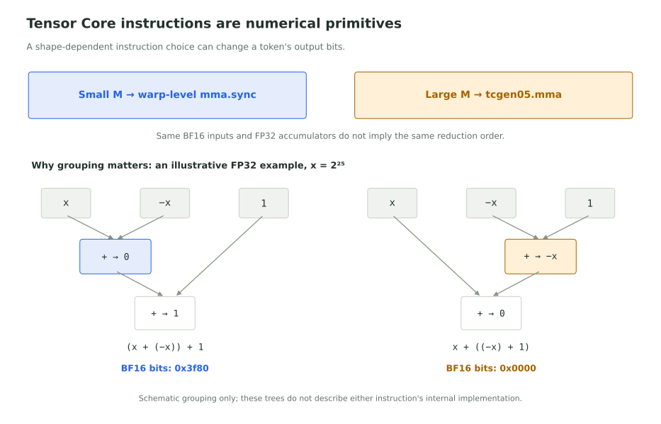

*The scalar trees illustrate the effect of regrouping; they do not claim to describe either instruction's internal accumulation order. With x = 2²⁵ and round-to-nearest-even FP32 addition, `(x + (-x)) + 1` is 1, while `x + ((-x) + 1)` is 0. Both results remain different after BF16 conversion.*

The instruction family is therefore a numerical choice as well as a performance choice. A fixed-shape repeatability test would miss the disagreement between the two paths. Tinygemm serves as an educational example here and is outside the performance study below.

### Split-K

Split-K is another common GEMM optimization. When M and N provide too few output tiles to occupy the GPU, multiple thread blocks can work on different segments of K. Each segment starts a new accumulator, and a later reduction combines the partial results. This exposes more parallel work, at the cost of partial-result traffic and a reduction step.

Restarting the accumulator changes the computation. An uninterrupted dot product rounds after each accumulation into one running state; a split computation rounds within each partial and again when combining them. Even a deterministic, index-ordered fixup can produce different bits from the uninterrupted fold. If the dispatcher changes the split count or boundaries with M, the same row can therefore change bits as the batch grows.

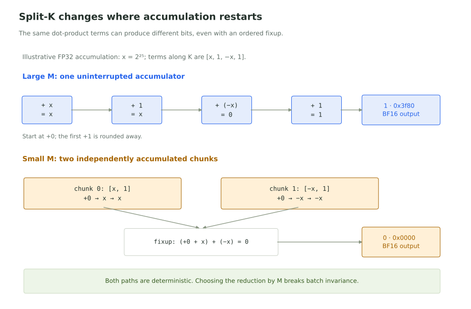

*The two paths are each deterministic, but their accumulation restarts differ. Selecting between them by batch size breaks batch invariance. This example needs no unordered atomics.*

Combining partials with floating-point atomics adds another issue: if their arrival order varies between launches, the result can also lose run-to-run determinism. These are distinct failure modes. A fixed reduction order addresses repeatability, while batch invariance also requires agreement across the execution paths selected for different batch sizes.

A common way existing batch-invariant GEMM APIs avoid this issue is to **disable split-K altogether**, keeping each output's K reduction uninterrupted. [Thinking Machines Lab's discussion of batch-invariant matrix multiplication](https://thinkingmachines.ai/blog/defeating-nondeterminism-in-llm-inference/) describes this straightforward approach. It avoids batch-dependent partitioning, but gives up a useful performance optimization precisely when small M and N provide too little parallel work.

## Designing fast kernels around a fixed numerical dataflow

FlashInfer's approach is to **fix the numerical dataflow, then optimize how the GPU executes it**. We developed the kernels in a generation harness that co-designs the numerical specification, Lean model, and kernel engine. Each candidate implementation must preserve the declared computation while exposing performance choices that are numerically interchangeable.

### Numerical classes fix the arithmetic

A **numerical class** specifies the rounded operations that produce one logical output element. It fixes the tensor-core primitive and its K-step width, the accumulator's initial value, the order of those steps, any chunk boundaries and partial-result fold, and the scaling, bias, and output-conversion chain. We call this per-element graph of operations the **canonical dataflow**. It is more specific than the real-valued equation `C = A × B`.

For example, the unsplit BF16 class starts from +0, executes the declared tensor-core steps in ascending K order with FP32 accumulation, and converts the completed accumulator to the output dtype once. Its biased variant adds bias to the fully reduced FP32 value before conversion. Low-precision classes also specify how their scales enter the computation. A different instruction primitive or reduction grouping defines a different class, even if both implementations are accurate approximations of the same matrix product.

An execution **configuration** chooses how to implement that class: tile sizes, cluster geometry, staging, raster order, and which CTA owns each piece of work. All admitted configurations within the same numerical class follow the same canonical dataflow and therefore share the **exact same numerics** for the same logical inputs. Changing the arithmetic requires a new specification fingerprint and renewed validation.

This gives a kernel-selection heuristic a clear rule for preserving bitwise batch invariance: for fixed N, K, operand format, and supported environment, choose configurations only from the selected numerical class. The heuristic can still depend on M and available GPU parallelism, recommending a smaller tile for decode and a larger tile for prefill, provided both belong to that class. Autotuning can search the same space. Switching between classes as M changes, such as a `tcgen05.mma` class and a warp-level `mma.sync` class, does not provide this bitwise guarantee.


*A heuristic may choose any admitted configuration within the selected class. It must preserve that class as M changes for a fixed weight shape. The two instruction families illustrate distinct numerical contracts; configurations within each class vary only in ways that preserve its dataflow.*

### Co-designing the proof and the kernel engine

The development harness gives kernel-generation agents a shared contract: produce the numerical specification, the kernel implementation, the Lean model and conformance cases, and the bitwise tests together. Performance tuning operates under the same contract. A faster candidate that changes the bits does not qualify as another configuration of that class.

The specification is executable. A reduction describes ordered folds over tensor-core K steps and, when present, over chunks. An elementwise epilogue declares the operations after that reduction. The canonical engine lowers these objects into a plan; the GEMM mainloop executes its blocked instruction sequence, and the epilogue uses the shared operation chain. The kernel body supplies loaders, staging, synchronization, and stores around that computation.

The engine can also execute against a symbolic algebra, emitting the operation expressions rather than GPU instructions. Generated cases connect these expressions, the enumerated configuration records, and dispatcher selections to an independently written Lean model. This coupling checks that the proof describes the dataflow and configuration space used by the generator. An exact CPU evaluator checks the explicitly modeled floating-point operations; tensor-core instructions remain named, opaque primitives.

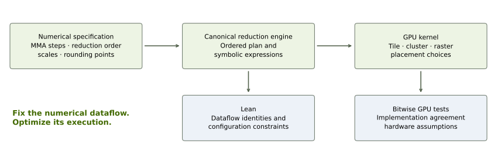

*Specification, engine, and proof are developed together. Symbolic conformance connects the Python generator to Lean; GPU conformance checks the implementation and the hardware assumptions that the proof leaves opaque.*

Lean proves identities about reduction placement, blocked-loop execution, and ordered split reductions. Its launch model states determinism, batch invariance, permutation invariance, and sub-batch invariance. Configuration-space checks separately establish that the dispatcher's generated choices belong to the admitted space. The [implementation documentation](https://github.com/flashinfer-ai/flashinfer/blob/3db2f474e4053a6400d3128ba0683cbd4a05f5a4/flashinfer/batch_invariant/README.md) describes the classes, conformance tests, and proof-checking commands.

The proof boundary is explicit. Tensor-core operations are opaque primitives in the model. Bitwise GPU tests check that the admitted instruction and tiling variants implement the assumed per-element function, alongside batch and configuration agreement. The result is **Lean-verified numerical dataflow backed by bitwise GPU conformance checks**; compiler correctness, hardware internals, and complete CUDA concurrency are outside these proofs. The proof repository also checks its trust policy: no `sorry`, Lean's standard axioms, and a named set of exhaustive checks using `native_decide`.

### Partitioning N and K to retain split-K

Batch invariance holds the weight dimensions N and K fixed while token rows change. That gives us room to choose different numerical classes for different weight shapes. FlashInfer partitions this space into an **uninterrupted K-fold region** and an **ordered chunk-fold region**. Within the latter, separate classes fix chunk counts C = 2, 4, 8, and higher. Format and architecture also participate in class selection; M does not.

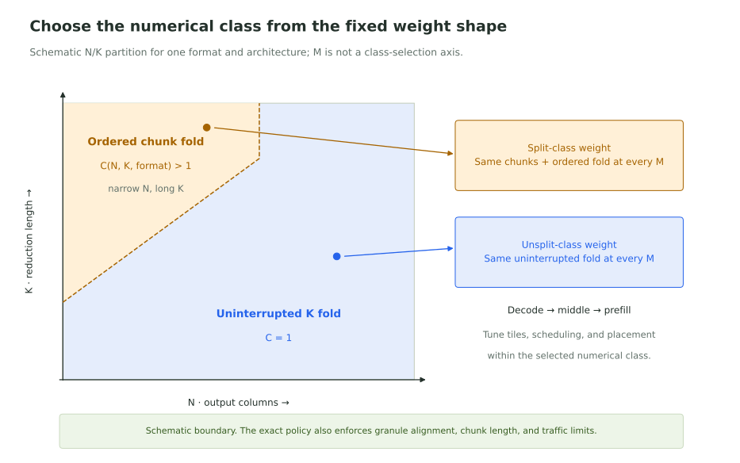

*A weight shape selects its numerical class independently of batch size. The split region contains several fixed chunk-count classes. This diagram is schematic; the policy-derived maps below include the actual alignment and size constraints.*

For a chunked class, each of C fixed K segments starts from a fresh +0 accumulator. The FP32 partials are then added from +0 in chunk-index order, followed by the declared epilogue. A weight that uses these boundaries at decode retains them at prefill. The Lean split-reduction model establishes equality to this chunked specification independently of the assignment of chunks to CTAs.

The execution can still change substantially as M changes:

- Different CTAs compute partials into an index-addressed workspace; a fixup kernel folds them in order.
- One CTA computes successive chunks and retains the ordered running sum in tensor memory.
- Admitted block-scaled configurations exchange partials within a cluster and apply the same ordered fold.

These are placements of the same chunked computation. In particular, running every chunk inside one CTA does not turn it into an uninterrupted K fold: accumulator restarts and the ordered partial additions remain. This preserves the numerical contract while allowing a small batch to expose more parallel work and a large batch to avoid a global partial-result buffer.

Split-K preserves batch invariance when the same chunked dataflow applies at every M. The class rule uses the fixed weight shape to retain splitting where it helps. Changing tensor-parallel degree or slicing a weight changes N or K and therefore requires a separate consistency analysis.

### Where do the N/K class boundaries fall?

These boundaries are implemented by an **analytical heuristic over the fixed weight dimensions**. The rule is designed to expose more parallel work where it is scarce while controlling the cost of splitting:

1. **Check the parallelism supplied by N.** Consider splitting only when `ceil(N / 32) < 256`; wider outputs already supply many independent tiles.
2. **Limit partial-result traffic.** Require `C <= floor(K / (16*N))`. For BF16, this bounds the FP32 partial-buffer round trip to one quarter of the BF16 activation bytes. Long K relative to N leaves more room for useful splitting.
3. **Keep each chunk useful and aligned.** Each chunk must contain whole format granules and at least 256 K elements. Choose the largest power-of-two C up to 128 satisfying all constraints, or C=1 when none qualifies.

Together, these rules place the chunked classes mainly in narrow-N, long-K regions. Power-of-two counts create stepped boundaries, and divisibility constraints create stripes and cutouts. The rule uses the appropriate granule for each format and depends on neither M nor the available SM count; the 256-tile cutoff is a fixed policy constant. SM count can guide execution-configuration selection within the chosen numerical class. Ordinary unsharded transformer shapes often remain unsplit.

On SM107, NVFP4 has another N/K-dependent choice: ordinary unsplit regions use a 128-element MMA step, while split regions use its 64-element step. Both decisions depend on the fixed weight shape. Neither depends on M.


*Numerical-class boundaries evaluated from FlashInfer's analytical selection rule, independently of M. Colors show the selected chunk count; alignment-dependent stripes reflect whole-chunk granules. The maps show the boundaries without benchmark-shape overlays and extend beyond the measured dimensions to illustrate the policy. They are not performance heatmaps. Reproducer data covers FP8, MXFP8, and MXFP4 as well.*

## Enabling batch-invariant GEMMs in FlashInfer

The numerical-class selection and configuration dispatch are exposed through a new **`batch_invariant=True`** input flag on FlashInfer's public GEMM APIs. The flag requires **`backend="auto"`**. Together, they select the batch-invariant mode, which chooses the numerical class from the fixed weight dimensions and selects execution configurations within that class:

```python
import flashinfer

y = flashinfer.mm_bf16(
    a,
    w.T,
    backend="auto",
    batch_invariant=True,
)
```

The mode validates its supported inputs; unsupported combinations, including an explicitly selected backend other than `"auto"`, raise an error. Its heuristic and autotuner both stay within the selected class's invariant configuration space.

| Public API | Input format |
| --- | --- |
| `mm_bf16` | BF16 |
| `bmm_fp8` | Per-tensor-scaled FP8 |
| `mm_mxfp8` | Block-scaled MXFP8 |
| `mm_fp4` | NVFP4 or MXFP4 |

For prequantized NVFP4 operands and their block scales, the selection is the same:

```python
y = flashinfer.mm_fp4(
    a_fp4,
    w_fp4.T,
    a_scale,
    w_scale,
    alpha,
    backend="auto",
    batch_invariant=True,
)
```

The selected class has a fingerprint, scoped to its defining dimensions, library version, and architecture. The same mode and numerical inputs must be used on both sides of a consistency comparison.

The inputs to that contract must also stay consistent. For example, recomputing an activation scale over a changing batch can change the quantized operands before a GEMM starts. A batch-invariant GEMM preserves its own computation; the surrounding pipeline must supply the same numerical inputs.

That architecture scope matters on Rubin. Some block-scaled instructions process a wider K step than their Blackwell counterparts. FlashInfer treats those as distinct classes and makes the selection independent of token count. The API does not promise that changing the GPU architecture or weight partitioning preserves every bit.

## GEMM performance on NVIDIA Vera Rubin NVL4

We evaluate decode, middle-sized batches, and prefill using eight representative transformer projection shapes. The selected N and K values cover common hidden, attention, and feed-forward dimensions: N is the output dimension and K is the input dimension of a weight. M is the number of token rows.

| Projection archetype | N | K |
| --- | --- | --- |
| 4K hidden projection | 4096 | 4096 |
| GQA fused QKV projection | 6144 | 4096 |
| FFN up/gate projection | 14336 | 4096 |
| FFN down projection | 4096 | 14336 |
| 8K hidden projection | 8192 | 8192 |
| FFN up/gate projection | 28672 | 8192 |
| FFN down projection | 8192 | 28672 |
| Output-sharded projection | 1024 | 28672 |

The M sweep covers decode (M ≤ 16), middle-sized batches (16 < M < 1024), and prefill (M ≥ 1024). Separate narrow-N/long-K shapes probe the split-K region. The measurements characterize representative GEMMs, with each shape/M pair weighted equally in its regime.

For BF16, **FI batch invariant** is compared with the batch-invariant paths from PyTorch Inductor/Triton, vLLM Triton, and DeepGEMM deterministic BF16. The non-BI comparators are FlashInfer's regular CUTLASS, cuDNN, and CuTe DSL backends; BF16 CuTe DSL is included only for decode (M ≤ 16). BI labels describe the selected paths within the validated shape matrix.

For NVFP4, we compare FI batch invariant with **vLLM BI W4A4** and the non-BI FI CuTe DSL backend. Both operands are prequantized, so the measurement isolates GEMM; all paths return BF16 output.

Every comparator appears in both untuned and autotuned studies. Backends with no runtime tuning interface retain their upstream table, heuristic, or fixed configuration in both studies. See the [methodology and software appendix](#appendix-methodology) for timing procedures, versions, build targets, tuning modes, and correctness scope. The [full latency curves](#appendix-latency-curves) retain the per-shape detail.

### BF16 results

The autotuned FI batch invariant GEMM is faster in geometric mean than every measured BI competitor in decode and middle regimes. At prefill it is faster than the measured PyTorch Inductor/Triton and vLLM Triton paths and near parity with DeepGEMM (0.99×). Against non-BI backends, it is close to cuDNN, slower than the decode-only BF16 CuTe DSL path, and faster than the measured regular CUTLASS path.

Each bar is comparator latency divided by its matched FI batch invariant latency. **Above 1× favors FI batch invariant.** The top row is untuned and the bottom row is autotuned. BI comparator names are bold and tagged **[BI]**; other names are tagged [non-BI].

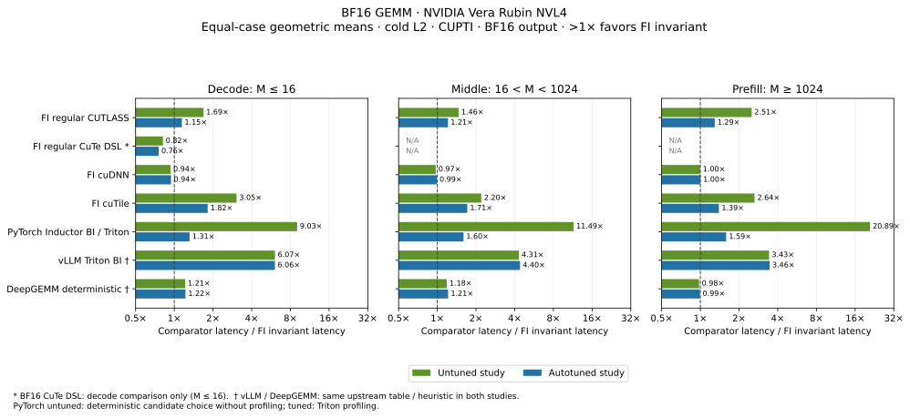

*Equal-case geometric means on NVIDIA Vera Rubin NVL4. The dashed 1× line is FI batch invariant. The untuned and autotuned BF16 rows use different labeled log-axis ranges. FI CuTe DSL is decode-only. vLLM and DeepGEMM retain their upstream table and heuristic in both rows.*

PyTorch's untuned row uses its deterministic candidate selector without profiling. Triton profiling gives a much stronger comparison; the autotuned row is the relevant reference for its best measured configuration. Detailed selection modes and the separate narrow-N correctness probe are described in the [appendix](#appendix-methodology).

### Prequantized NVFP4 results

FI batch invariant is close to the regular FI CuTe DSL backend across the representative shapes, and faster in geometric mean than vLLM BI W4A4 in every regime. With autotuning, FI batch invariant has approximately 12% higher decode latency and 4% higher middle-regime latency than regular CuTe DSL, with approximately equal prefill latency. The narrower output shape has a larger cost, which remains visible in the [per-shape curves](#appendix-latency-curves).

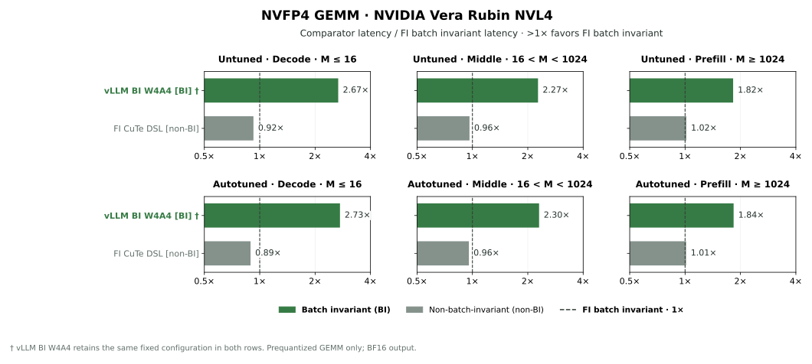

*The same ratio as BF16: comparator latency / FI batch invariant latency; above 1× favors FI batch invariant. Both operands are prequantized and output is BF16. vLLM BI W4A4 keeps its fixed upstream configuration in both rows. These are GEMM timings on NVIDIA Vera Rubin NVL4.*

### Hypothetical study: giving up split-K

**Suppose we had disabled split-K to simplify batch invariance.** We evaluate this hypothetical design choice using actual measurements of an unsplit alternative to FlashInfer's chunked numerical classes. The displayed study covers seven shapes inside the split region, with policy-selected C ranging from 2 to 16, at M=1, 16, 128, 1024, and 8192. These narrow-output shapes form a separate ablation from the primary transformer matrix; the bars and heatmap use the same seven-shape selection.

The ablation forces C=1 through FlashInfer's internal class entry point and uses its unchanged dispatcher and autotuner for that class. Both sides receive identical operands and use the same MMA primitive and epilogue. For NVFP4, both sides retain the split region's 64-element primitive; the ablation does not also switch to the ordinary unsplit region's wider instruction. Tuning profiles the same top-configuration policy separately for each class.

Removing chunking changes the reduction contract, so the two sides need not return identical bits. Each side must independently pass batch-invariance checks, and its tuned result must equal its own default result bit for bit.

We express the ablation as **performance retained after giving up split-K**:

`retained performance = unsplit throughput / policy-class throughput = policy-class latency / unsplit latency`

A value of 0.5× means half the performance, or a 50% loss; 1× means no change. With autotuning, giving up split-K retains **0.54×** BF16 decode performance (a **46% loss**) and **0.78×** NVFP4 decode performance (a **22% loss**) in geometric mean over the seven selected split-region shapes.

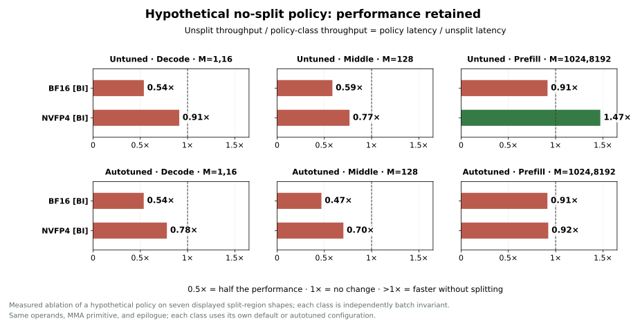

*A measured ablation of a hypothetical no-split policy. Both classes are independently batch invariant. Values below the dashed 1× line show the cost of removing chunking; values above 1× show an improvement. The same MMA primitive and epilogue are retained on both sides.*

Some prefill cases improve without chunking, and these remain above 1×. A fixed chunk contract exposes decode parallelism and also fixes the arithmetic that larger batches must retain. Autotuning improves the aggregate tradeoff without making every chunked case faster.

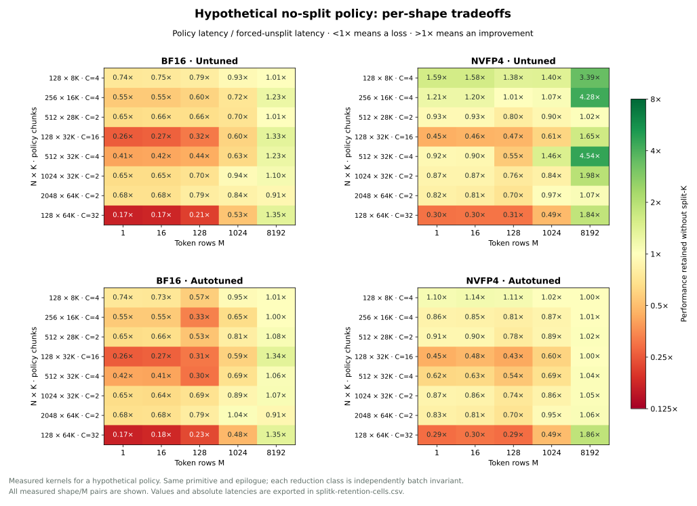

*The hypothetical no-split policy uses the same seven shapes and retained-performance definition as the bars, with untuned and autotuned rows. The complete eight-shape sweep remains in the [reproduction artifacts](#appendix-reproduction), with display-selection flags in the retained-performance CSV.*

## From consistent GEMMs to consistent RL

GEMMs account for a large part of a model's forward pass, but phase consistency spans the rest of that pass too. Attention must preserve a token's computation across prefill, decode, and KV partitioning. Normalization and log-probability reductions need stable numerical contracts. Quantization scales, fused activations, and tensor-parallel collectives must agree between the trainer and rollout engine. Sampling also needs request-level random-state semantics when reproducible responses are required.

These GEMMs are the first part of our broader work on numerical consistency for RL. We are continuing to develop and verify other operators, including attention, normalization, quantization, and sampling/log-probability APIs. We will discuss their numerical contracts, kernel design, and performance in subsequent parts of this blog series.

For an RL framework, the integration task is to use the same contract for each matching forward computation. A kernel-level guarantee does not establish deterministic training updates or prove that two complete model implementations agree. It provides a stable building block for doing that work.

The engineering direction is to make numerical behavior an explicit part of the API. Once the dataflow is fixed and checked, performance work can explore how to execute it efficiently—from one-token decode to large prefill—while preserving the computation that the RL pipeline relies on.

<a id="appendix-reproduction"></a>

## Appendix: reproducing the measurements

The [reproduction bundle](/assets/data/rl-ready-kernels/flashinfer-rl-study.tar.gz) contains the exact measured harness snapshots, backend adapters, source and environment manifests, selected tuning configurations, generated-code provenance, correctness checks, raw per-iteration timing samples, absolute-latency CSVs, and figure scripts. It also includes the N/K class-policy map and both modes of the split-K ablation. The [archive checksum](/assets/data/rl-ready-kernels/SHA256SUMS) and the bundle's internal file checksums allow the artifacts to be verified before rerunning them.

The guide inside the bundle explains source provisioning, idle-device admission, exact-snapshot replay, and figure regeneration. Kernel timings describe the stated implementations and shapes on NVIDIA Vera Rubin NVL4; they do not imply end-to-end RL speedups.

The [CPU-only figure reproducer](/assets/data/rl-ready-kernels/figure-reproducer.zip) contains the plotting scripts and frozen analysis inputs for the current figures. The [display ratios](/assets/data/rl-ready-kernels/display-ratios.csv) and [split-K retained-performance cells](/assets/data/rl-ready-kernels/splitk-retention-cells.csv) expose the exact values behind the bars and heatmap. [Figure-artifact checksums](/assets/data/rl-ready-kernels/FIGURE_SHA256SUMS) accompany these files; the original measurement bundle is retained unchanged.

<a id="appendix-methodology"></a>

## Appendix: methodology and software

The main results use the following environment, timing procedure, backend configurations, and correctness checks. The full token-count sweep is M=1, 2, 4, 8, 16, 32, 64, 128, 256, 512, 1024, 2048, 4096, and 8192.


The device is NVIDIA Vera Rubin NVL4, SM107, with 212 SMs and 126 MiB of L2. The reproducibility artifacts record exact source commits, compiler and library versions, device UUIDs, input recipes, generated-code provenance, and timing samples. Measurements use only reserved, idle GPUs 2 and 3 on the host.

| Software | Measured version |
| --- | --- |
| NVIDIA driver / CUDA compiler | 620.43 / 13.4.92 |
| PyTorch | 2.14.1+cu132 |
| CuTe DSL / CUPTI Python | 4.8.1 / 13.5.0 |
| cuDNN library / frontend | 9.24.0.43 / 1.32.2 |
| FlashInfer source | `3db2f474e4053a6400d3128ba0683cbd4a05f5a4` |
| vLLM source | `aeadf9252586e9db0e7658312d562036b45cd217` |
| vLLM CUTLASS dependency | v4.7.1, `cb4247394dd82148787aed73e5dc7cef33cbf862` |
| DeepGEMM source | `5081f8513af57e61696de4f4f04b0e707ffb503e` |

The FlashInfer measurements use the source checkout above. Its editable-install build metadata still reports 0.7.3; the recorded source commit and import path identify the implementation measured here.

We use `flashinfer.testing.bench_gpu_time` with CUPTI, cold L2, and CUDA graph replay. L2 flushing occurs before each iteration, outside the measured operation. The reported time spans the first kernel's start through the last kernel's end, including split-K fixup where applicable. Compilation, initialization, and any preparation or tuning occur before timing. Backend order is shuffled across three rounds, and absolute latency accompanies throughput and ratios. Clocks and temperature are recorded; clocks are not locked.

Each case has 50 samples per round. Across the campaign, the median spread between round medians is 0.53%; the 95th percentile is 12.5%, with a maximum of 36.9%. Some BF16 first rounds are slower than later rounds; follow-up five-round probes reproduce this warming effect and are archived separately. All reported medians retain all three rounds. As a sensitivity check, omitting the first round changes any reported regime-level geometric mean by at most 0.51%. This is an aggregate sensitivity check, not a bound on individual cases. Near-parity results should be read as approximate parity, not a precise ranking.

Both studies return BF16 output. The NVFP4 study uses identical prequantized packed operands, block-scale values, and alpha across implementations. It measures **GEMM only**. Activation quantization and weight preparation are outside the timing boundary.

BF16 compares FlashInfer's invariant GEMM with its regular CUTLASS, CuTe DSL, and cuDNN backends. It separately compares PyTorch `torch.compile` using TorchInductor's batch-invariant option, vLLM's persistent Triton kernel, and DeepGEMM's deterministic BF16 kernel. These have separate rows throughout the study. The regular backends provide performance context; they do not supply the invariant contract measured here. We restrict the BF16 CuTe DSL comparison to decode (M <= 16); its middle and prefill entries are unavailable.

The PyTorch path is restricted to Triton GEMM code generation with external ATen GEMM fallback disabled. Each problem shape is specialized; generated code and bitwise behavior are checked before admission. This measures the stated Inductor/Triton configuration. The vLLM Triton measurement loads the unchanged upstream kernel and wrapper with its architecture/shape configuration tables; platform queries use this GPU's properties. It measures that named kernel, independently of vLLM's default Rubin dispatch. DeepGEMM uses its native `bf16_gemm_nt` entry with `use_deterministic_algorithms(True)`, which bypasses its cuBLAS dispatch.

NVFP4 compares FlashInfer's invariant GEMM, its regular CuTe DSL backend, and vLLM's CUTLASS W4A4 kernel with batch-invariant execution enabled. The vLLM measurement binds the unchanged upstream CUDA source with its pinned CUTLASS dependency; it measures the kernel operation rather than serving-engine overhead.

The vLLM kernel uses the SM100-family compatibility target (`sm_100f`) on this machine. Its pinned CUTLASS version does not provide native SM107 feature guards. FlashInfer selects its SM107 implementation. The reproducer records this build distinction and the exact source hashes.

DeepGEMM's pinned CUTLASS 4.2.1 has the same native-SM107 feature-guard limitation. Its unchanged BF16 kernel is also compiled for `sm_100f`, through DeepJIT's compiler-path option and a target-only adapter. The source, heuristic, actual compiler arguments, and generated-code hashes are preserved. In this revision, DeepGEMM's native FP4 path uses MXFP4 scaling; its explicit NVFP4 entry is cuBLAS-backed and does not enter this study. [The pinned source](https://github.com/deepseek-ai/DeepGEMM/blob/5081f8513af57e61696de4f4f04b0e707ffb503e/csrc/apis/gemm.hpp) identifies these separate paths.

Every comparison is reported in both an untuned and an autotuned study. Tuning time is excluded from steady-state GPU latency, selected configurations are archived, and FlashInfer's tuned invariant output must equal its untuned output bit for bit.

| Backend | Batch Invariant | Untuned study | Autotuned study |
| --- | --- | --- | --- |
| FI batch invariant | Yes | Default selection without profiling | FlashInfer tactic profiling |
| FI regular CUTLASS, CuTe DSL, cuDNN | No | Default selection without profiling | FlashInfer tactic profiling |
| PyTorch Inductor BI/Triton | Yes | Deterministic candidate selection without profiling | Triton candidate profiling |
| vLLM persistent Triton BI | Yes | Upstream architecture/shape table | Same upstream table; no runtime tuning interface |
| vLLM BI W4A4 | Yes | Fixed upstream configuration | Same fixed configuration; no runtime tuning interface |
| DeepGEMM deterministic BF16 | Yes | Upstream heuristic | Same heuristic; no native BF16 runtime tuning interface |

The two vLLM paths therefore appear in both studies with their actual selection modes stated. Accuracy is checked against CPU FP64 reference slices at every measured shape. Invariant paths additionally undergo integer-view bitwise checks across batch sizes and dispatch boundaries. Each performance ratio uses the invariant control measured in the same sweep.

The PyTorch option passes the primary eight-shape matrix in both modes. A separate narrow-N probe at N=128, K=8192 finds bitwise differences between M=129 and M=8192 in both modes; its reproducer is included, and that path is excluded from the split-region ablation. The comparisons establish behavior for the validated matrix rather than a blanket guarantee for a compiler option.


### Absolute-latency examples

For absolute-latency examples, the table below fixes N=K=4096 and uses the autotuned study. Each row shows its own matched FI batch invariant control; the full curves and CSV include every measured shape.

| M | Comparator | Batch Invariant | FI batch invariant (µs) | Comparator (µs) |
| ---: | --- | --- | ---: | ---: |
| 1 | PyTorch Inductor BI / Triton | Yes | 7.94 | 11.65 |
| 1 | DeepGEMM deterministic BF16 | Yes | 8.08 | 10.11 |
| 1 | FI cuDNN | No | 7.97 | 7.55 |
| 8192 | PyTorch Inductor BI / Triton | Yes | 81.12 | 115.07 |
| 8192 | DeepGEMM deterministic BF16 | Yes | 81.92 | 82.78 |
| 8192 | FI cuDNN | No | 81.41 | 80.86 |

<a id="appendix-latency-curves"></a>

## Appendix: full latency curves

The full primary shape grid is retained below for both selection modes. BI legend names are bold; non-BI paths are explicitly marked. FI BF16 CuTe DSL remains restricted to M ≤ 16.

<details markdown="1">
  <summary>All untuned BF16 latency curves</summary>

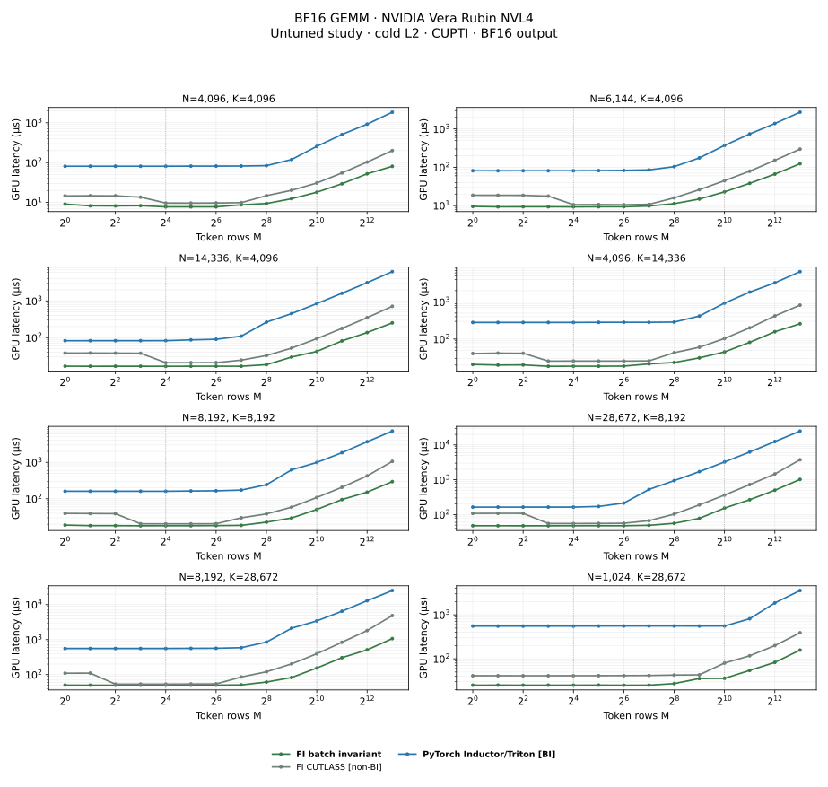


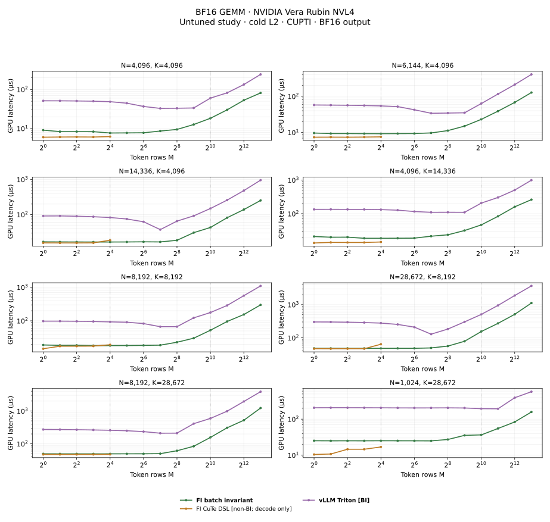


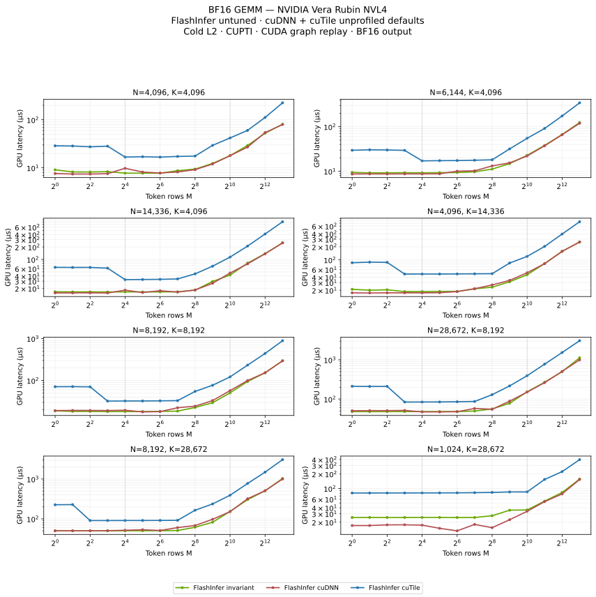


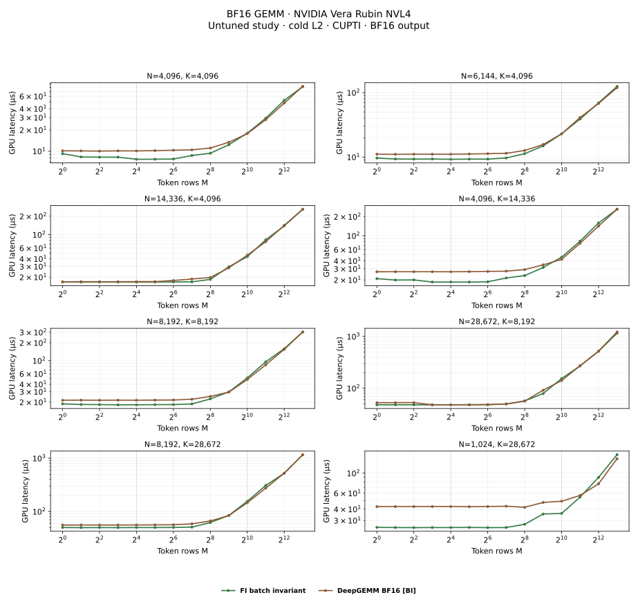

</details>

<details markdown="1">
  <summary>All autotuned BF16 latency curves</summary>

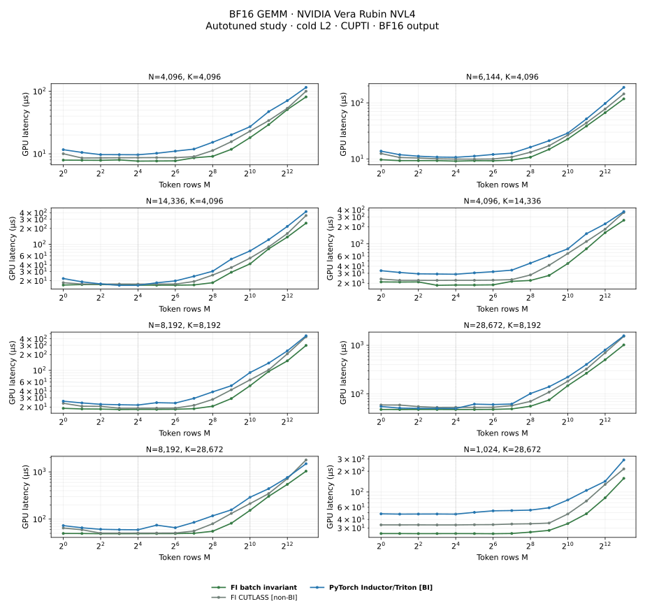


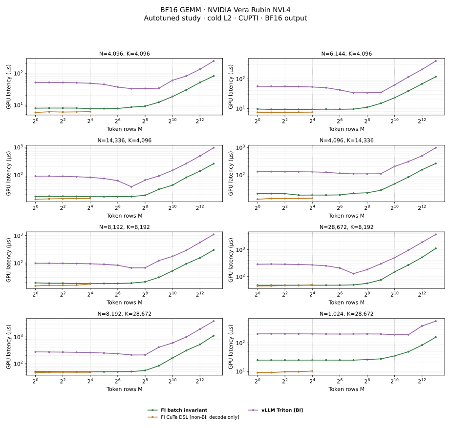


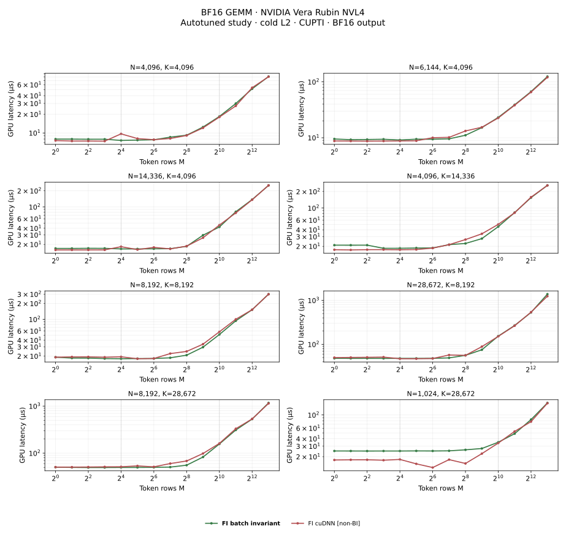


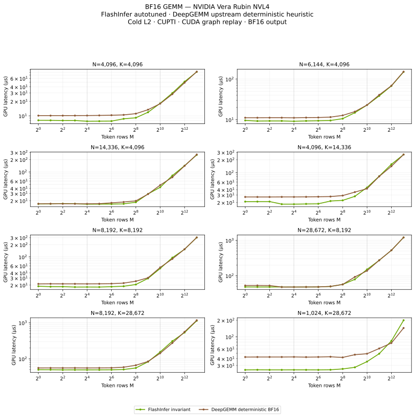

</details>

<details markdown="1">
  <summary>All autotuned NVFP4 latency curves</summary>

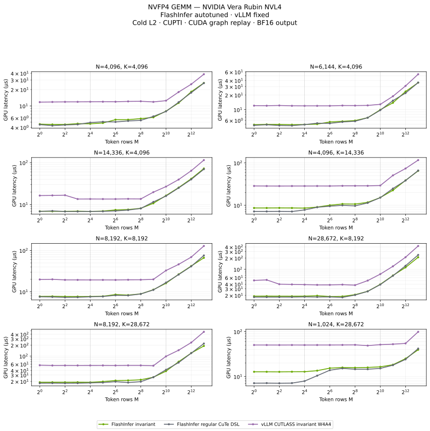

*Autotuned FlashInfer NVFP4 paths and fixed vLLM BI W4A4 on NVIDIA Vera Rubin NVL4. Both operands are prequantized and output is BF16. Lower latency is better. Dashed vertical lines mark M=16 and M=1024.*

</details>

<details markdown="1">
  <summary>Untuned NVFP4 curves for all eight shapes</summary>

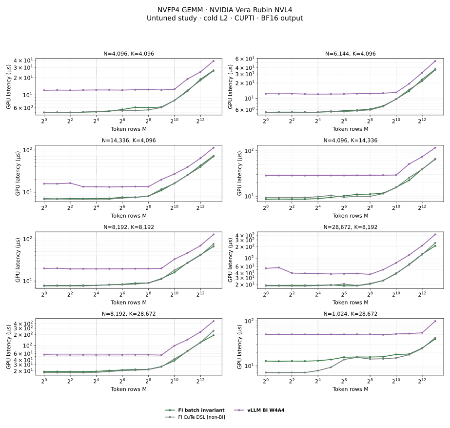

*Untuned FI batch invariant and regular CuTe DSL paths, with the same fixed vLLM BI W4A4 comparator. The raw samples and absolute latency table are retained in the reproducer artifacts.*

</details>
