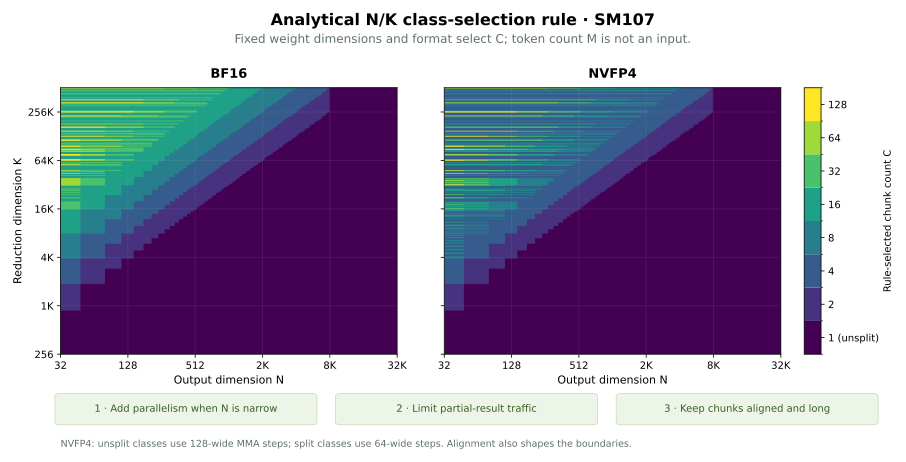

<!-- Review draft. Results come from the complete, audited Vera Rubin NVL4
     study. Copy this post and its referenced assets together for publication. -->

Reinforcement learning asks a model to evaluate the same tokens in different ways. A rollout engine generates responses a few tokens at a time. A trainer later processes those responses in larger batches to compute log probabilities and updates. Both may use the same weights, yet produce different numbers.

One source of that mismatch is below the model: GPU kernels change their arithmetic as the batch changes. A matrix multiplication that uses one reduction at decode may use another at prefill. Floating-point addition is not associative, so changing the order of accumulation can change the output bits. A fixed random seed does not fix a changing reduction order.

FlashInfer's approach starts with a numerical contract: **fix the numerical dataflow, then optimize how the GPU executes it.** The dataflow determines each output's bits. The implementation can change tile shapes, work assignment, and scheduling while preserving that dataflow. Lean proofs establish identities about the numerical model, and bitwise GPU tests check that the generated implementations agree.

FlashInfer [v0.7.4](https://github.com/flashinfer-ai/flashinfer/releases/tag/v0.7.4) introduced this mode for BF16, FP8, MXFP8, NVFP4, and MXFP4 GEMMs on Blackwell and Rubin. This post explains the contract, how it leaves room for performance optimization, and how we evaluate it on **NVIDIA Vera Rubin NVL4**.

## Why batch invariance matters for RL

Consider a linear layer with activations `A[M, K]`, weights `W[N, K]`, and output `Y[M, N] = A @ W.T`. The token count M changes throughout serving and training. N and K describe the weight shape.

A batch-invariant GEMM returns the same output bits for a token whether it runs alone, alongside other tokens, at another row position, or as part of a larger prefill. Its result depends on that token's inputs and the fixed numerical contract for the weight.

Several related properties matter:

| Property | What must remain equal |
| --- | --- |
| Determinism | Repeated executions of the same inputs |
| Batch invariance | A token evaluated under different batching, padding, row order, or sub-batching |
| Configuration agreement | Different admitted kernel configurations for the same numerical class |
| Phase consistency | Different execution paths for the same logical operation, including prefill and decode |

Determinism alone covers the first row. A deterministic kernel can still change its result when M changes. Likewise, two independently batch-invariant implementations can define different accumulation orders. Matching a rollout engine and a trainer requires agreement on the numerical contract as well as invariance within each implementation.

This distinction is relevant when the trainer re-scores a sampled response. With the same policy weights and inputs, the rollout probabilities and recomputed probabilities should describe the same numerical policy. A discrepancy introduced by batching or kernel selection adds a source of drift before an update has occurred.

The [vLLM and TorchTitan demonstration](https://vllm.ai/blog/2025-11-10-bitwise-consistent-train-inference) illustrates the need to coordinate complete forward passes. [SGLang's work on deterministic inference and reproducible RL](https://www.lmsys.org/blog/2025-09-22-sglang-deterministic/) shows how batching, chunked prefill, sampling, and training settings interact. FlashInfer supplies consistent primitives for that broader integration.

## The performance tension

The shapes that make a GPU efficient change dramatically between decode and prefill. With thousands of token rows, a GEMM has many independent output tiles. With one or a few rows, the kernel needs other ways to expose enough parallel work and keep memory transfers efficient.

High-performance implementations adapt tile dimensions, use different tensor-core instructions, change persistent scheduling, or partition the reduction across K. Those choices become a numerical problem when they change the sequence of operations used for an output element.

Increasing accumulation precision helps accuracy, but FP32 additions still depend on order. Freezing an entire launch configuration also leaves useful hardware choices unexplored. The opportunity is to identify which choices determine the arithmetic and which choices only place that arithmetic on the GPU.

FlashInfer makes that distinction explicit. A **numerical class** defines the operations. An admitted **configuration** implements the class using a particular placement. The dispatcher and autotuner choose among configurations that agree on the numerical result.

### The tensor-core instruction is part of the numerics

Split-K is a common example of an optimization that changes accumulation order. Switching the tensor-core instruction family can do so as well, even on the same GPU.

SM100-family GPUs, including SM107 in Vera Rubin NVL4, can execute Ampere-style warp-level `mma.sync` instructions as well as SM100-style `tcgen05.mma` instructions. Warp-level MMA operates on register fragments, while `tcgen05` uses asynchronous execution and tensor-memory accumulators, with different staging and completion costs. The Ampere-style path has lower instruction latency, which can make it useful for latency-bound BF16 GEMMs with very few token rows. FlashInfer's tinygemm backend uses this approach; its SM100-family implementation issues `mma.sync.aligned.m16n8k16` with BF16 operands and FP32 accumulators.

Those two instruction families need not group and accumulate products in the same order. BF16 inputs and FP32 accumulation therefore do not, by themselves, establish numerical equivalence. A dispatcher that selects warp-level MMA for a small M and `tcgen05` for a larger M can change a token's output bits as the batch changes. Each path may be deterministic on its own while the combination fails batch invariance.

For the invariant mode, the instruction primitive is part of the numerical class. An implementation may tune admitted variants that preserve that primitive's per-element behavior; switching to another instruction family requires establishing the same bitwise contract. This is why the instruction choice belongs alongside reduction partitions and rounding points in the specification. Tinygemm illustrates the numerical issue here; it is not included in the performance comparison below.

## A numerical contract behind the API

The public GEMM APIs select the mode with `batch_invariant=True` and `backend="auto"`:

```python
import flashinfer

y = flashinfer.mm_bf16(
    a,
    w.T,
    backend="auto",
    batch_invariant=True,
)
```

The mode provides its own implementation and validates its supported inputs. Unsupported combinations raise an error. Its autotuner searches within the invariant configuration space.

| Public API | Input format |
| --- | --- |
| `mm_bf16` | BF16 |
| `bmm_fp8` | Per-tensor-scaled FP8 |
| `mm_mxfp8` | Block-scaled MXFP8 |
| `mm_fp4` | NVFP4 or MXFP4 |

For prequantized NVFP4 operands and their block scales, the selection is the same:

```python
y = flashinfer.mm_fp4(
    a_fp4,
    w_fp4.T,
    a_scale,
    w_scale,
    alpha,
    backend="auto",
    batch_invariant=True,
)
```

For an unsplit BF16 GEMM, the contract is a sequence of tensor-core K steps with FP32 accumulation from an initial +0, followed by one output conversion. The biased variant adds the bias once to the fully reduced FP32 accumulator before conversion. Other formats define their own instruction steps and scale application.

The contract is more specific than a real-valued matrix product. It includes the accumulation structure, scale operations, and rounding points that determine the output bits. FlashInfer gives each class a fingerprint, scoped to its defining dimensions, library version, and architecture.

The inputs to that contract must also stay consistent. For example, recomputing an activation scale over a changing batch can change the quantized operands before a GEMM starts. A batch-invariant GEMM preserves its own computation; the surrounding pipeline must supply the same numerical inputs.

That architecture scope matters on Rubin. Some block-scaled instructions process a wider K step than their Blackwell counterparts. FlashInfer treats those as distinct classes and makes the selection independent of token count. The API does not promise that changing the GPU architecture or weight partitioning preserves every bit.

## Canonical dataflow, Lean proofs, and a kernel engine

FlashInfer defines the numerical specification separately from the performance configuration. A canonical reduction engine lowers that specification into an ordered plan. The GEMM mainloop uses that lowering to issue its tensor-core steps, and the epilogue applies the declared scaling, bias, and conversion chain.

The same engine can emit symbolic expressions. Those expressions connect the Python specification and lowering to a Lean model of the dataflow.


*The numerical specification fixes the computation; placement choices determine its execution. Lean verification and GPU conformance checks cover distinct parts of the implementation chain.*


### What the proofs establish

The Lean development proves identities about reduction placement, blocked-loop execution, and ordered split reductions. Its launch model states the batch, permutation, and sub-batch invariance properties. Generated conformance cases compare Lean's expressions with those emitted by the Python specification and engine, and check configuration-space and dispatcher constraints.

This allows performance choices to remain flexible. Tile ownership, cluster geometry, raster order, and other admitted placements can depend on M. They preserve the class's per-element arithmetic.

The proof boundary is explicit. Tensor-core operations are opaque primitives in the model. GPU configuration-agreement tests check that the admitted instruction and tiling variants implement the assumed per-element function. The result is **Lean-verified numerical dataflow backed by bitwise GPU conformance checks**; compiler correctness, hardware internals, and complete CUDA concurrency are outside these proofs.

The proof repository also checks its trust policy: no `sorry`, Lean's standard axioms, and a named set of exhaustive checks that use `native_decide`. The [implementation documentation](https://github.com/flashinfer-ai/flashinfer/blob/3db2f474e4053a6400d3128ba0683cbd4a05f5a4/flashinfer/batch_invariant/README.md) explains the classes, supported inputs, conformance tests, and commands for checking the proofs.

### Split-K can preserve batch invariance

Split-K partitions a dot product into partial reductions. The numerical issue is how those partitions and their combination change as M changes.

FlashInfer defines a chunked numerical class for selected weight shapes. Each chunk starts with a fresh accumulator. The chunk partials are then added in a fixed index order with specified FP32 operations, followed by the epilogue chain.

The chunk count depends on **N, K, and the operand format**. It does not depend on M. A weight that uses this class at decode uses the same chunk boundaries at prefill.

There are several ways to execute that class:

- Different CTAs compute partials into an index-addressed workspace; a fixup kernel folds them in order.
- One CTA computes successive chunks and retains the ordered running sum in tensor memory.
- Admitted block-scaled configurations exchange partials within a cluster and apply the same ordered fold.

These placements implement the chunked specification. The chunked specification can differ from a single uninterrupted K fold, so switching freely between arbitrary split and unsplit arithmetic would change the contract.

FlashInfer's weight-shape policy considers splitting when N supplies too little parallel work. It aligns chunks to whole format granules, enforces a minimum chunk length, and limits the extra FP32 partial traffic. Ordinary unsharded transformer shapes often remain unsplit. Narrow-N, long-K shapes expose the cases where controlled splitting is useful.

This is also how to interpret coverage over the non-batch dimensions: each N/K region selects a numerical class, and that class remains consistent as M changes. Changing tensor-parallel degree or slicing a weight can change those fixed dimensions and requires a separate consistency analysis.

### Where do the N/K class boundaries fall?

There are two broad reduction families—an uninterrupted K fold and an ordered chunk fold—with separate chunked classes for C=2, 4, 8, and higher. The precise numerical class also includes the format, instruction primitive, scale chain, and rounding points.

For the inspected policy, splitting is considered only when `ceil(N / 32) < 256`. The policy chooses the largest power-of-two C up to 128 that satisfies three constraints: `C <= floor(K / (16*N))`, each chunk contains whole format granules, and each chunk has at least 256 K elements. It uses C=1 when no larger count qualifies. For BF16, the traffic constraint bounds the FP32 partial-buffer round trip to one quarter of the BF16 activation bytes. The same count rule uses the appropriate granule for the other formats.

On SM107, NVFP4 has another N/K-dependent choice: ordinary unsplit regions use a 128-element MMA step, while split regions use its 64-element step. Both decisions depend on the fixed weight shape. Neither depends on M.




*Numerical-class regions evaluated from FlashInfer's actual policy, independently of M. The alignment-dependent stripes reflect whole-chunk granules. The map extends beyond the measured shapes to illustrate the policy; it is not a performance heatmap. Reproducer data covers FP8, MXFP8, and MXFP4 as well.*


## GEMM performance on NVIDIA Vera Rubin NVL4

We evaluate decode, middle-sized batches, and prefill using eight transformer projection shapes. M is the number of token rows; N and K are the output and input dimensions of a weight.

| Projection archetype | N | K |
| --- | --- | --- |
| 4K hidden projection | 4096 | 4096 |
| GQA fused QKV projection | 6144 | 4096 |
| FFN up/gate projection | 14336 | 4096 |
| FFN down projection | 4096 | 14336 |
| 8K hidden projection | 8192 | 8192 |
| FFN up/gate projection | 28672 | 8192 |
| FFN down projection | 8192 | 28672 |
| Output-sharded projection | 1024 | 28672 |

The M sweep is 1, 2, 4, 8, 16, 32, 64, 128, 256, 512, 1024, 2048, 4096, and 8192. Separate diagnostic shapes cover narrow-N/long-K split-K regimes. These are GEMM projection archetypes, not complete-model benchmarks.

### Methodology

The device is NVIDIA Vera Rubin NVL4, SM107, with 212 SMs and 126 MiB of L2. The reproducibility artifacts record exact source commits, compiler and library versions, device UUIDs, input recipes, generated-code provenance, and timing samples. Measurements use only reserved, idle GPUs 2 and 3 on the host.

| Software | Measured version |
| --- | --- |
| NVIDIA driver / CUDA compiler | 620.43 / 13.4.92 |
| PyTorch | 2.14.1+cu132 |
| CuTe DSL / CUPTI Python | 4.8.1 / 13.5.0 |
| cuTile | 1.8.0 |
| cuDNN library / frontend | 9.24.0.43 / 1.32.2 |
| FlashInfer source | `3db2f474e4053a6400d3128ba0683cbd4a05f5a4` |
| vLLM source | `aeadf9252586e9db0e7658312d562036b45cd217` |
| vLLM CUTLASS dependency | v4.7.1, `cb4247394dd82148787aed73e5dc7cef33cbf862` |
| DeepGEMM source | `5081f8513af57e61696de4f4f04b0e707ffb503e` |

The FlashInfer measurements use the source checkout above. Its editable-install build metadata still reports 0.7.3; the recorded source commit and import path identify the implementation measured here.

We use `flashinfer.testing.bench_gpu_time` with CUPTI, cold L2, and CUDA graph replay. L2 flushing occurs before each iteration, outside the measured operation. The reported time spans the first kernel's start through the last kernel's end, including split-K fixup where applicable. Compilation, initialization, and any preparation or tuning occur before timing. Backend order is shuffled across three rounds, and absolute latency accompanies throughput and ratios. Clocks and temperature are recorded; clocks are not locked.

Each case has 50 samples per round. Across the campaign, the median spread between round medians is 0.53%; the 95th percentile is 12.5%, with a maximum of 36.9%. Some BF16 first rounds are slower than later rounds; follow-up five-round probes reproduce this warming effect and are archived separately. All reported medians retain all three rounds. As a sensitivity check, omitting the first round changes any reported regime-level geometric mean by at most 0.51%. This is an aggregate sensitivity check, not a bound on individual cases. Near-parity results should be read as approximate parity, not a precise ranking.

Both studies return BF16 output. The NVFP4 study uses identical prequantized packed operands, block-scale values, and alpha across implementations. It measures **GEMM only**. Activation quantization and weight preparation are outside the timing boundary.

BF16 compares FlashInfer's invariant GEMM with its regular CUTLASS, CuTe DSL, cuDNN, and cuTile backends. It separately compares PyTorch `torch.compile` using TorchInductor's batch-invariant option, vLLM's persistent Triton kernel, and DeepGEMM's deterministic BF16 kernel. These have separate rows throughout the study. The regular backends provide performance context; they do not supply the invariant contract measured here. We restrict the BF16 CuTe DSL comparison to decode (M <= 16); its middle and prefill entries are unavailable.

The PyTorch path is restricted to Triton GEMM code generation with external ATen GEMM fallback disabled. Each problem shape is specialized; generated code and bitwise behavior are checked before admission. This measures the stated Inductor/Triton configuration. The vLLM Triton measurement loads the unchanged upstream kernel and wrapper with its architecture/shape configuration tables; platform queries use this GPU's properties. It measures that named kernel, independently of vLLM's default Rubin dispatch. DeepGEMM uses its native `bf16_gemm_nt` entry with `use_deterministic_algorithms(True)`, which bypasses its cuBLAS dispatch.

NVFP4 compares FlashInfer's invariant GEMM, its regular CuTe DSL backend, and vLLM's CUTLASS W4A4 kernel with batch-invariant execution enabled. The vLLM measurement binds the unchanged upstream CUDA source with its pinned CUTLASS dependency; it measures the kernel operation rather than serving-engine overhead.

The vLLM kernel uses the SM100-family compatibility target (`sm_100f`) on this machine. Its pinned CUTLASS version does not provide native SM107 feature guards. FlashInfer selects its SM107 implementation. The reproducer records this build distinction and the exact source hashes.

DeepGEMM's pinned CUTLASS 4.2.1 has the same native-SM107 feature-guard limitation. Its unchanged BF16 kernel is also compiled for `sm_100f`, through DeepJIT's compiler-path option and a target-only adapter. The source, heuristic, actual compiler arguments, and generated-code hashes are preserved. In this revision, DeepGEMM's native FP4 path uses MXFP4 scaling; its explicit NVFP4 entry is cuBLAS-backed and does not enter this study. [The pinned source](https://github.com/deepseek-ai/DeepGEMM/blob/5081f8513af57e61696de4f4f04b0e707ffb503e/csrc/apis/gemm.hpp) identifies these separate paths.

Every comparison is reported in both an untuned and an autotuned study. Tuning time is excluded from steady-state GPU latency, selected configurations are archived, and FlashInfer's tuned invariant output must equal its untuned output bit for bit.

| Backend | Batch Invariant | Untuned study | Autotuned study |
| --- | --- | --- | --- |
| FI invariant | Yes | Default selection without profiling | FlashInfer tactic profiling |
| FI regular CUTLASS, CuTe DSL, cuDNN | No | Default selection without profiling | FlashInfer tactic profiling |
| FI cuTile | No | GPU-specific default configuration | Native cuTile exhaustive search |
| PyTorch Inductor BI/Triton | Yes | Deterministic candidate selection without profiling | Triton candidate profiling |
| vLLM persistent Triton BI | Yes | Upstream architecture/shape table | Same upstream table; no runtime tuning interface |
| vLLM invariant W4A4 | Yes | Fixed upstream configuration | Same fixed configuration; no runtime tuning interface |
| DeepGEMM deterministic BF16 | Yes | Upstream heuristic | Same heuristic; no native BF16 runtime tuning interface |

The two vLLM paths therefore appear in both studies with their actual selection modes stated. The cuTile timing includes its required output zeroing. Its untuned adapter retains kernel objects through CUDA graph capture and replay; it preserves the upstream kernel and default launch configuration. Accuracy is checked against CPU FP64 reference slices at every measured shape. Invariant paths additionally undergo integer-view bitwise checks across batch sizes and dispatch boundaries. Each performance ratio uses the invariant control measured in the same sweep.

The PyTorch option passes the primary eight-shape matrix in both modes. A separate narrow-N probe at N=128, K=8192 finds bitwise differences between M=129 and M=8192 in both modes; its reproducer is included, and that path is excluded from the split-region ablation. The comparisons establish behavior for the validated matrix rather than a blanket guarantee for a compiler option.

### BF16 results

<!-- BEGIN GENERATED BF16 RESULTS -->
The tuned invariant GEMM is faster in geometric mean than every measured batch-invariant competitor in decode and middle regimes. At prefill it is faster than the measured PyTorch Inductor/Triton and vLLM Triton paths and near parity with DeepGEMM (0.99x). Against non-BI comparators, it is close to cuDNN, slower than the decode-only BF16 CuTe DSL path, and faster than the measured regular CUTLASS and cuTile paths. The cost of invariance depends on the comparator and regime.

The ratio below is comparator latency / FlashInfer invariant latency, paired within each sweep. Above 1x favors FlashInfer invariant. The FlashInfer invariant control is **Batch Invariant: Yes** in every row; the column classifies the comparator's selected mode within the validated matrix. The selection methods are defined in the methodology table.

| FI selection | Comparator | Batch Invariant | Decode | Middle | Prefill |
| --- | --- | --- | ---: | ---: | ---: |
| Untuned | PyTorch Inductor BI / Triton | Yes | 9.03x | 11.49x | 20.89x |
| Untuned | vLLM persistent Triton BI (upstream table) | Yes | 6.07x | 4.31x | 3.43x |
| Untuned | DeepGEMM deterministic BF16 (heuristic) | Yes | 1.21x | 1.18x | 0.98x |
| Untuned | FI regular CUTLASS | No | 1.69x | 1.46x | 2.51x |
| Untuned | FI cuDNN | No | 0.94x | 0.97x | 1.00x |
| Untuned | FI cuTile | No | 3.05x | 2.20x | 2.64x |
| Untuned | FI CuTe DSL (decode only) | No | 0.82x | N/A | N/A |
| Autotuned | PyTorch Inductor BI / Triton | Yes | 1.31x | 1.60x | 1.59x |
| Autotuned | vLLM persistent Triton BI (upstream table) | Yes | 6.06x | 4.40x | 3.46x |
| Autotuned | DeepGEMM deterministic BF16 (heuristic) | Yes | 1.22x | 1.21x | 0.99x |
| Autotuned | FI regular CUTLASS | No | 1.15x | 1.21x | 1.29x |
| Autotuned | FI cuDNN | No | 0.94x | 0.99x | 1.00x |
| Autotuned | FI cuTile | No | 1.82x | 1.71x | 1.39x |
| Autotuned | FI CuTe DSL (decode only) | No | 0.76x | N/A | N/A |

PyTorch's untuned row uses its deterministic candidate selector without profiling. Normal Triton profiling gives a much stronger comparison; the autotuned row is the relevant reference when assessing the best measured Inductor configuration. vLLM and DeepGEMM retain their upstream table and heuristic in both studies. FI CuTe DSL is compared only through M=16.


*BF16 comparisons on NVIDIA Vera Rubin NVL4. Each ratio uses the invariant control measured with that comparator. Both study modes are shown; a backend without a runtime search retains its stated upstream selection.*

For absolute-latency examples, the table below fixes N=K=4096 and uses the autotuned study. Each row shows its own matched invariant control; the full curves and CSV include every measured shape.

| M | Comparator | Batch Invariant | FI invariant (µs) | Comparator (µs) |
| ---: | --- | --- | ---: | ---: |
| 1 | PyTorch Inductor BI / Triton | Yes | 7.94 | 11.65 |
| 1 | DeepGEMM deterministic BF16 | Yes | 8.08 | 10.11 |
| 1 | FI cuDNN | No | 7.97 | 7.55 |
| 8192 | PyTorch Inductor BI / Triton | Yes | 81.12 | 115.07 |
| 8192 | DeepGEMM deterministic BF16 | Yes | 81.92 | 82.78 |
| 8192 | FI cuDNN | No | 81.41 | 80.86 |

<details markdown="1">
  <summary>All untuned BF16 latency curves</summary>


</details>

<details markdown="1">
  <summary>All autotuned BF16 latency curves</summary>


</details>
<!-- END GENERATED BF16 RESULTS -->

### Prequantized NVFP4 results

The invariant mode is close to regular CuTe DSL on most of the eight shapes. The narrow output projection has a larger latency cost, so we report every shape as well as aggregate results. Against vLLM's fixed invariant W4A4 configuration, FlashInfer's invariant implementation is faster in geometric mean in each regime.

The table reports baseline latency divided by FlashInfer invariant latency. Above 1x favors FlashInfer invariant. Each geometric mean gives equal weight to the measured shape/M pairs in its regime.

| FlashInfer selection | Comparator | Batch Invariant | Decode | Middle | Prefill |
| --- | --- | --- | ---: | ---: | ---: |
| Untuned | Untuned regular CuTe DSL | No | 0.92x | 0.96x | 1.02x |
| Untuned | Fixed vLLM invariant W4A4 | Yes | 2.67x | 2.27x | 1.82x |
| Autotuned | Autotuned regular CuTe DSL | No | 0.89x | 0.96x | 1.01x |
| Autotuned | Fixed vLLM invariant W4A4 | Yes | 2.73x | 2.30x | 1.84x |

For the autotuned comparison with regular CuTe DSL, those ratios correspond to approximately 12% higher decode latency and 4% higher middle-regime latency in geometric mean, with approximately equal prefill latency. The curves show where those costs occur. These measurements describe GEMMs; they do not measure end-to-end RL throughput.


*Autotuned FlashInfer NVFP4 paths and fixed vLLM invariant W4A4 on NVIDIA Vera Rubin NVL4. Both operands are prequantized and output is BF16. Lower latency is better. Dashed vertical lines mark M=16 and M=1024.*


<details markdown="1">
  <summary>Untuned NVFP4 curves for all eight shapes</summary>


*Untuned FlashInfer invariant and regular CuTe DSL paths, with the same fixed vLLM invariant W4A4 comparator. The raw samples and absolute latency table are retained in the reproducer artifacts.*

</details>

### Split-K diagnostic

What would we lose if we gave up splitting? We evaluate eight shapes inside the split region, with C ranging from 2 to 32, at M=1, 16, 128, 1024, and 8192. These narrow-output shapes are a separate study from the primary transformer matrix.

The ablation forces C=1 through FlashInfer's internal class entry point and uses its unchanged dispatcher and autotuner for that class. Both sides receive identical operands and use the same MMA primitive and epilogue. For NVFP4, both sides retain the split region's 64-element primitive; the ablation does not also switch to the ordinary unsplit region's wider instruction. Tuning profiles the same top-configuration policy separately for each class.

Removing chunking changes the reduction contract, so the two sides need not return identical bits. Each side must independently pass batch-invariance checks, and its tuned result must equal its own default result bit for bit.

| Format | Selection | Batch Invariant | Decode: M=1,16 | Middle: M=128 | Prefill: M=1024,8192 |
| --- | --- | --- | ---: | ---: | ---: |
| BF16 | Untuned | Yes | 2.15x | 1.94x | 1.10x |
| BF16 | Autotuned | Yes | 2.15x | 2.34x | 1.11x |
| NVFP4 | Untuned | Yes | 1.26x | 1.46x | 0.72x |
| NVFP4 | Autotuned | Yes | 1.45x | 1.59x | 1.08x |

The ratio is forced-unsplit latency divided by the policy-class latency. Above 1x favors the chunked class. With autotuning, removing chunking costs 2.15x latency in BF16 decode and 1.45x in NVFP4 decode in geometric mean over these selected shapes.

The tradeoff is visible at prefill. Some shapes run faster without chunks, and the untuned NVFP4 chunked path has a substantial aggregate prefill cost. Autotuning improves that aggregate, but it does not make every chunked case faster. At N=128, K=65536, for example, tuned chunking provides about 5.92x BF16 speedup at M=1, while its ratio falls to 0.74x at M=8192. A fixed chunk contract creates useful decode parallelism and also constrains the arithmetic that large batches must retain.


*The cost of giving up chunking at a fixed MMA primitive. Each cell compares independently batch-invariant numerical classes. Both selection modes and every measured shape are shown; absolute latencies and samples are archived.*


## From consistent GEMMs to consistent RL

GEMMs account for a large part of a model's forward pass, but phase consistency spans the rest of that pass too. Attention must preserve a token's computation across prefill, decode, and KV partitioning. Normalization and log-probability reductions need stable numerical contracts. Quantization scales, fused activations, and tensor-parallel collectives must agree between the trainer and rollout engine. Sampling also needs request-level random-state semantics when reproducible responses are required.

FlashInfer's current-main work extends the numerical-contract approach beyond the GEMMs introduced in v0.7.4. Its batch-invariant attention classes define fixed absolute KV tiles and chunks shared by supported prefill and decode wrappers. Quantization and sampling/log-probability APIs have their own specified chains and conformance checks. These features have individual input and execution constraints, documented alongside their APIs.

For an RL framework, the integration task is to use the same contract for each matching forward computation. A kernel-level guarantee does not establish deterministic training updates or prove that two complete model implementations agree. It provides a stable building block for doing that work.

The engineering direction is to make numerical behavior an explicit part of the API. Once the dataflow is fixed and checked, performance work can explore how to execute it efficiently—from one-token decode to large prefill—while preserving the computation that the RL pipeline relies on.

## Reproduce the measurements

The [reproduction bundle](/assets/data/rl-ready-kernels/flashinfer-rl-study.tar.gz) contains the exact measured harness snapshots, backend adapters, source and environment manifests, selected tuning configurations, generated-code provenance, correctness checks, raw per-iteration timing samples, absolute-latency CSVs, and figure scripts. It also includes the N/K class-policy map and both modes of the split-K ablation. The [archive checksum](/assets/data/rl-ready-kernels/SHA256SUMS) and the bundle's internal file checksums allow the artifacts to be verified before rerunning them.

The guide inside the bundle explains source provisioning, idle-device admission, exact-snapshot replay, and figure regeneration. Kernel timings describe the stated implementations and shapes on NVIDIA Vera Rubin NVL4; they do not imply end-to-end RL speedups.
